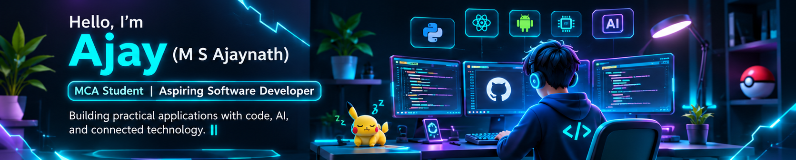
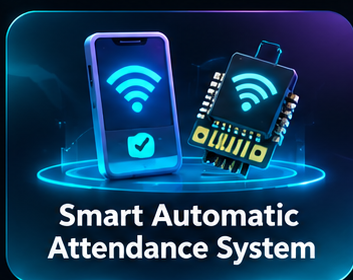
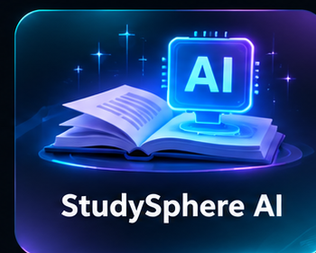
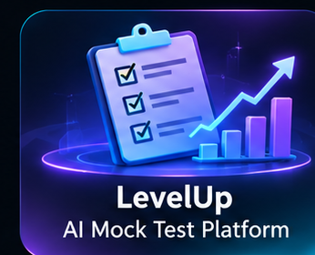

# ☕ Hey, I'm Ajay!

### M S Ajaynath · MCA Student · Aspiring Software Developer

*Curious mind. Creative builder. Always learning.*

📍 Palakkad, Kerala, India · 🎓 RIT Kottayam · 🌱 Expected graduation: 2027

---

<table>
<tr>
<td width="62%" valign="top">

## 🌿 A little about me

Hello! I'm Ajay, an MCA student who enjoys turning ideas into useful applications.

I'm interested in full-stack development, AI, mobile applications, and IoT. I like understanding how things work, experimenting with new tools, and learning through projects.

- 💻 Building web applications and backend services
- 🤖 Exploring machine learning and AI integrations
- 📱 Interested in Android development
- 🔌 Experimenting with IoT and connected devices
- 🌱 Growing one project at a time

</td>
<td width="38%" valign="top">

## 🍵 At a glance

| | |
|---|---|
| 🎓 | MCA student |
| 🏫 | RIT, Kottayam |
| 📅 | Class of 2027 |
| 💡 | Intermediate skill level |
| 💼 | Open to opportunities |

</td>
</tr>
</table>

---

## 🧶 My developer toolkit

**Languages**

**Frontend & backend**

**Databases & tools**

| Category | Skills |
|---|---|
| **Programming** | Python, JavaScript, Java, C, C++ |
| **Frontend** | HTML, CSS, React |
| **Backend** | Flask, Node.js, Express |
| **Databases** | PostgreSQL, MySQL |
| **AI & intelligent systems** | Machine Learning |
| **Mobile & IoT** | Android / Java, ESP-12E |
| **Developer tools** | Git, GitHub, Docker |

---

## 🪴 Projects I've been working on

*Small ideas, practical solutions, and plenty of learning along the way.*

<table>
<tr>
<td width="50%" valign="top">

### ⚡ Smart Automatic Attendance

Connecting mobile development, backend services, and IoT hardware to explore automated attendance.

**Tech:** Android · Python · Flask · PostgreSQL · ESP-12E

[**Explore project ↗**](https://github.com/A-J-A-Y-nath/Smart-Automatic-Attendance-System)

</td>
<td width="50%" valign="top">

### 📰 Fake News Detection

Exploring text processing and machine-learning classification for fake-news detection.

**Tech:** Python · Flask · TF-IDF · scikit-learn

[**Explore project ↗**](https://github.com/A-J-A-Y-nath/Fake-News-Detection)

</td>
</tr>
<tr>
<td width="50%" valign="top">

### 🧠 StudySphere AI

An AI-assisted study application project exploring web interfaces and integrations with multiple AI providers.

**Tech:** React · JavaScript · AI integrations

[**Explore project ↗**](https://github.com/A-J-A-Y-nath/StudySphereAi)

</td>
<td width="50%" valign="top">

### 🎯 LevelUp — AI Mock Tests

A mock-test platform project focused on interactive practice and AI-assisted functionality.

**Tech:** React · Vite · Node.js · Express · OpenRouter

[**Explore project ↗**](https://github.com/A-J-A-Y-nath/LevelUp)

</td>
</tr>
</table>

My portfolio includes a mix of completed and in-progress projects.

---

## 📚 Currently learning & exploring

  

---

## 🌼 Let's connect

### Have an idea worth building?

I'm open to **internships, full-time opportunities, and collaborative projects**.

  

 

*“Stay curious, keep creating, and enjoy the little wins.”* 🌿

☕ **Built with curiosity and a cozy playlist.**

