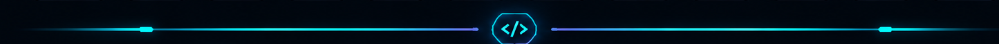

 

 

  

<code> MCA STUDENT </code> &nbsp; <code> ASPIRING SOFTWARE DEVELOPER </code>

  

📍 Palakkad, Kerala, India · 🎓 Expected graduation: 2027

  

---

## 

<table>
<tr>
<td width="65%" valign="top">

### `> whoami`

I'm **M S Ajaynath (Ajay)**, an MCA student at Rajiv Gandhi Institute of Technology, Kottayam.

I enjoy developing practical applications that combine software engineering, AI, and connected technology.

- `01` — Full-stack and backend development
- `02` — Artificial intelligence and machine learning
- `03` — Android application development
- `04` — IoT and connected devices
- `05` — Learning through hands-on projects

**Current mission:** Strengthen my engineering skills by designing, building, testing, and improving real-world applications.

</td>
<td width="35%" valign="top">

</td>
</tr>
</table>

---

## 

### `// LANGUAGES`

### `// FRONTEND & BACKEND`

### `// DATABASES & TOOLS`

 

  

---

## 

<table>
<tr>
<td width="50%" valign="top">

### ⚡ Smart Automatic Attendance System

An attendance project combining mobile application development, backend services, and IoT hardware.

**Stack:** Android · Python · Flask · PostgreSQL · ESP-12E

</td>
<td width="50%" valign="top">

### 📰 Fake News Detection

A machine-learning project focused on text processing and fake-news classification.

**Stack:** Python · Flask · TF-IDF · scikit-learn

</td>
</tr>
<tr>
<td width="50%" valign="top">

### 🧠 StudySphere AI

An AI-assisted study application project built around a web interface and multiple AI providers.

**Stack:** React · JavaScript · AI integrations

</td>
<td width="50%" valign="top">

### 🎯 LevelUp — AI Mock Test Platform

A web-based mock-test platform project designed around interactive practice and AI-assisted functionality.

**Stack:** React · Vite · Node.js · Express · OpenRouter

</td>
</tr>
</table>

---

## 

<table>
<tr>
<td width="50%" align="center" valign="middle">

### Introduction to Machine Learning

</td>
<td width="50%" align="center" valign="middle">

### Introduction to IoT

</td>
</tr>
</table>

---

## 

  

  

---

## 

### `> ready_to_build();`

Open to **internships, full-time opportunities, and collaborative projects**.

  

 

  

⚡ Curiosity is the fuel. Code is the tool. Innovation is the goal.

 

🐭 A tiny Pikachu-inspired Easter egg for fellow Pokémon fans.

